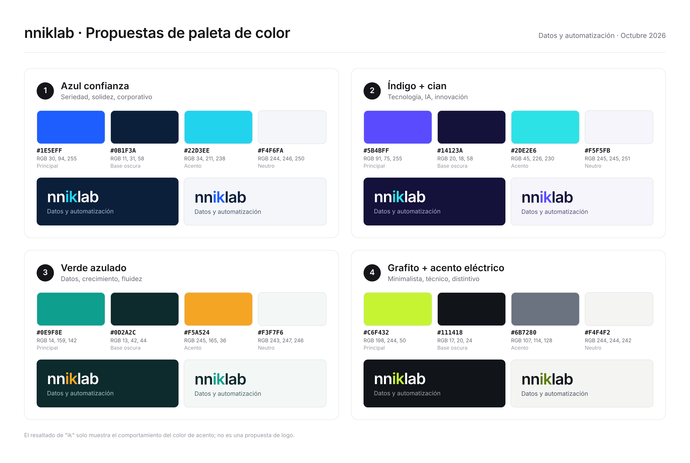

# Colores

Paleta de la marca con sus códigos HEX, RGB y CMYK. Se define a partir del logo.

## Propuestas en evaluación (2026-10-10)

1. **Azul confianza:** seriedad, solidez, corporativo.
2. **Índigo + cian:** tecnología, IA, innovación (recomendada por encajar con la IA en la propuesta de valor).
3. **Verde azulado:** datos, crecimiento, fluidez.
4. **Grafito + acento eléctrico:** minimalista, técnico, distintivo.

Pendiente: decisión del equipo.
