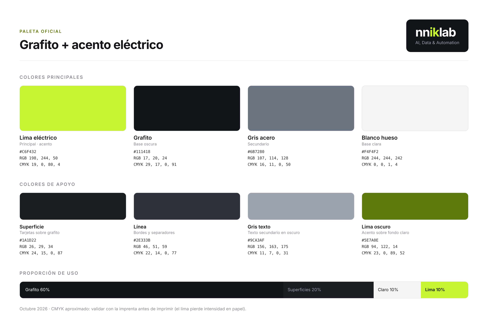

# Colores

## Paleta oficial: Grafito + acento eléctrico

Aprobada el 2026-10-10.

### Colores principales

| Color | Rol | HEX | RGB | CMYK |
|-------|-----|-----|-----|------|
| Lima eléctrico | Principal · acento | `#C6F432` | 198, 244, 50 | 19, 0, 80, 4 |
| Grafito | Base oscura | `#111418` | 17, 20, 24 | 29, 17, 0, 91 |
| Gris acero | Secundario | `#6B7280` | 107, 114, 128 | 16, 11, 0, 50 |
| Blanco hueso | Base clara | `#F4F4F2` | 244, 244, 242 | 0, 0, 1, 4 |

### Colores de apoyo

| Color | Uso | HEX | RGB | CMYK |
|-------|-----|-----|-----|------|
| Superficie | Tarjetas y paneles sobre grafito | `#1A1D22` | 26, 29, 34 | 24, 15, 0, 87 |
| Línea | Bordes y separadores | `#2E333B` | 46, 51, 59 | 22, 14, 0, 77 |
| Gris texto | Texto secundario sobre fondo oscuro | `#9CA3AF` | 156, 163, 175 | 11, 7, 0, 31 |
| Lima oscuro | Acento sobre fondo claro | `#5E7A0E` | 94, 122, 14 | 23, 0, 89, 52 |

### Proporción de uso

Grafito 60 % · superficies 20 % · claro 10 % · lima 10 %. El lima es el acento: se usa poco para que destaque.

### Reglas de contraste

| Combinación | Contraste | Uso |
|-------------|-----------|-----|
| Lima sobre grafito | 14,4 : 1 | Cualquier tamaño |
| Grafito sobre lima | 14,4 : 1 | Texto de botones y bloques lima |
| Grafito sobre blanco hueso | 16,8 : 1 | Cualquier tamaño |
| Gris texto sobre grafito | 7,3 : 1 | Texto secundario |
| Lima oscuro sobre blanco hueso | 4,5 : 1 | Acentos y texto en fondo claro |
| Gris acero sobre blanco hueso | 4,4 : 1 | Solo texto grande (18 px o más) |
| Gris acero sobre grafito | 3,8 : 1 | Solo texto grande o elementos gráficos |
| **Lima sobre blanco hueso** | **1,2 : 1** | **No usar nunca** |

### Notas de impresión

Los valores CMYK son aproximados. El lima es un color muy luminoso que pierde intensidad en papel: hay que validarlo con la imprenta con una prueba de color, o definir un Pantone equivalente, antes de imprimir tarjetas o material.

## Paleta de respaldo

La paleta naranja (opción 5) queda guardada para una futura actualización de la marca en `../../99-respaldo/paleta-naranja/`.
