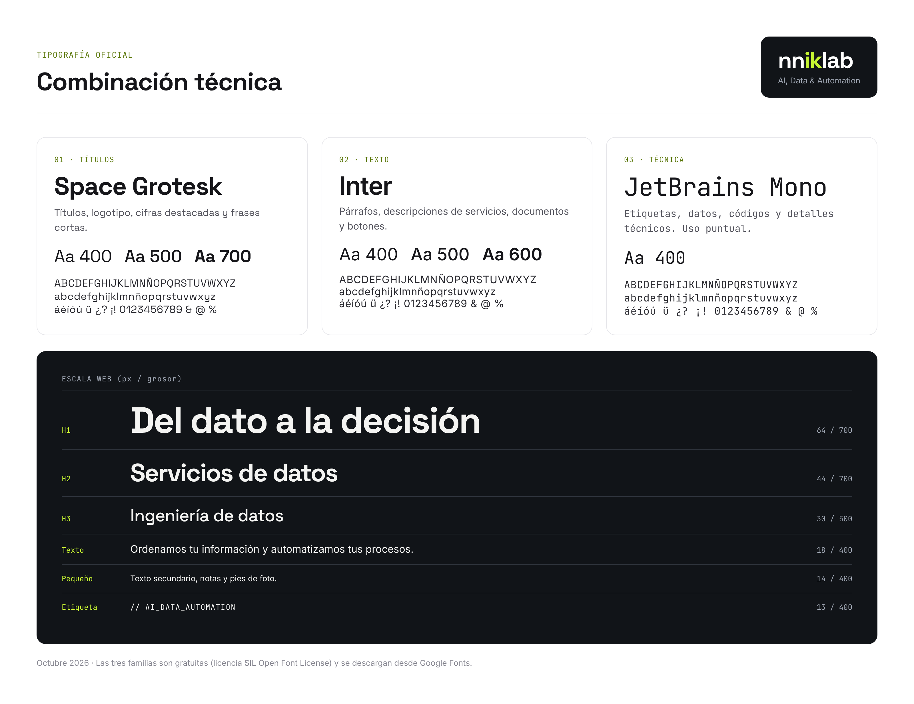

# Tipografía

## Tipografía oficial: combinación técnica

Aprobada el 2026-10-10.



| Papel | Familia | Grosores | Uso | Descarga |
|-------|---------|----------|-----|----------|
| **Títulos** | Space Grotesk | 400, 500, 700 | Títulos, logotipo, cifras destacadas, frases cortas | [Google Fonts](https://fonts.google.com/specimen/Space+Grotesk) |
| **Texto** | Inter | 400, 500, 600 | Párrafos, servicios, documentos, botones, formularios | [Google Fonts](https://fonts.google.com/specimen/Inter) |
| **Técnica** | JetBrains Mono | 400 | Etiquetas, datos, códigos, detalles técnicos (uso puntual) | [Google Fonts](https://fonts.google.com/specimen/JetBrains+Mono) |

Las tres son gratuitas con licencia SIL Open Font License: se pueden usar en web, documentos, impresos y productos comerciales sin coste.

## Escala web

| Nivel | Familia | Tamaño | Grosor | Interlineado | Espaciado |
|-------|---------|--------|--------|--------------|-----------|
| H1 | Space Grotesk | 64 px | 700 | 1,0 | −2 px |
| H2 | Space Grotesk | 44 px | 700 | 1,1 | −1,5 px |
| H3 | Space Grotesk | 30 px | 500 | 1,2 | −0,5 px |
| Texto | Inter | 18 px | 400 | 1,6 | 0 |
| Pequeño | Inter | 14 px | 400 | 1,5 | 0 |
| Etiqueta | JetBrains Mono | 13 px | 400 | 1,4 | +1 px |

En móvil: H1 40 px, H2 30 px, H3 22 px, texto 16 px.

## Escala para documentos e impresos

| Nivel | Familia | Tamaño | Grosor |
|-------|---------|--------|--------|
| Título | Space Grotesk | 28 pt | 700 |
| Subtítulo | Space Grotesk | 18 pt | 500 |
| Texto | Inter | 11 pt | 400 |
| Notas | Inter | 9 pt | 400 |
| Etiquetas | JetBrains Mono | 8–9 pt | 400 |

## Reglas de uso

- **Space Grotesk solo en títulos y textos cortos.** En párrafos largos cansa la lectura; para eso está Inter.
- **JetBrains Mono con moderación:** etiquetas, cifras técnicas o detalles de estilo "código". Nunca en párrafos.
- **Títulos con espaciado negativo** (letras más juntas) a partir de 30 px; el texto normal, sin ajuste.
- **Máximo dos grosores por pieza** además del texto normal, para mantener la limpieza.
- **Sin cursivas decorativas ni mayúsculas largas.** Las mayúsculas solo en etiquetas cortas en JetBrains Mono.
- **Español con tildes y ñ:** las tres familias las incluyen.

## Fuentes de reserva

Si alguna fuente no está instalada (por ejemplo, en un documento abierto en otro equipo):

| Familia | Reserva |
|---------|---------|
| Space Grotesk | Arial, Helvetica, sans-serif |
| Inter | Arial, Helvetica, sans-serif |
| JetBrains Mono | Consolas, "Courier New", monospace |

Para que documentos y presentaciones se vean igual en todos los equipos, conviene instalar las tres familias en las computadoras del equipo.

## Uso en web (CSS)

```css
@import url('https://fonts.googleapis.com/css2?family=Inter:wght@400;500;600&family=JetBrains+Mono:wght@400&family=Space+Grotesk:wght@400;500;700&display=swap');

--font-titulos: 'Space Grotesk', Arial, Helvetica, sans-serif;
--font-texto:   'Inter', Arial, Helvetica, sans-serif;
--font-tecnica: 'JetBrains Mono', Consolas, 'Courier New', monospace;
```

## Logotipo

El logotipo de nniklab partirá de Space Grotesk, pero se ajustará a mano en el diseño del logo para que sea único (ver `../logo/`).
